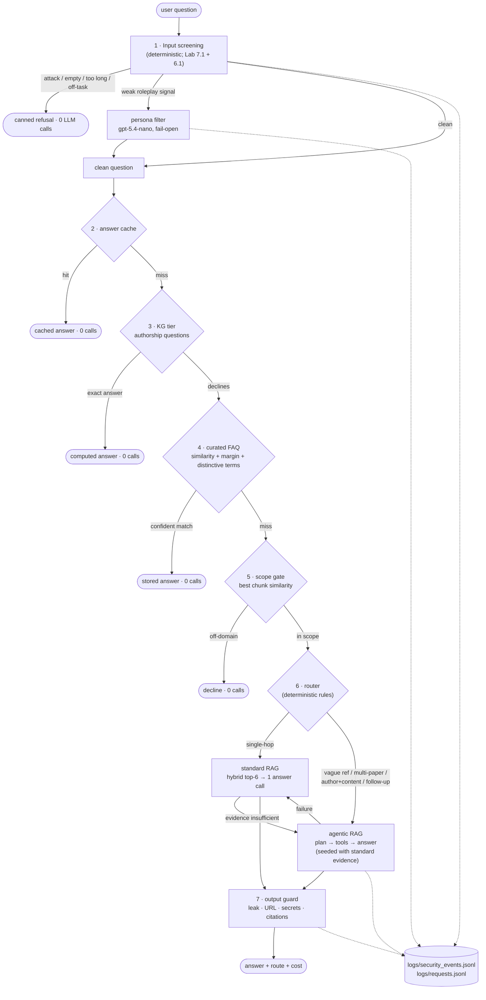

# AVT-411 Research Paper Navigator

A retrieval-augmented question-answering service over the NATO AVT-411 Research Specialists'
Meeting papers (machine learning and surrogate modelling for military vehicle design). It
answers questions about the papers with citations, refuses attacks and off-topic requests,
and spends model calls only where they change the answer.

This is the production package of the capstone (Checkpoint 7.1). It integrates, as one
application:

- the Checkpoint 2.1/3.1 hybrid retriever (BM25 + vectors);
- the Checkpoint 4.1 knowledge graph;
- the Checkpoint 5.1 tool-using agent;
- the Checkpoint 6.1 security layers;
- the Lab 7.1 input safeguards;
- a new cost-optimised router with a quick-lookup FAQ layer.

The test corpus is 25 papers; the deployment target is 200+.

---

## 1. Quick start

```bash
python -m venv .venv
.venv\Scripts\activate                 # macOS/Linux: source .venv/bin/activate
pip install -r requirements-dev.txt    # runtime + pytest
copy .env.example .env                 # then put your OpenRouter key in .env

python -m avt411 ingest                # index the PDFs in "Research Papers/" (incremental)
python -m avt411 build-faq             # build data/faq.json from testInputs.json
python -m avt411 ask "Which papers did Pellegrini and Diez write together?"
python -m avt411 chat                  # multi-turn session
python -m pytest                       # offline test suite (no key, no network)
```

All commands run from the project root. `python -m avt411 -h` lists them.

### Required environment

| Variable | Required | Purpose |
|---|---|---|
| `OPENROUTER_API_KEY` | yes | OpenRouter key; every model is called through OpenRouter's OpenAI-compatible API |
| `AVT411_*` | no | Override any default in `avt411/config.py` (paths, models, thresholds); see `.env.example` |

Secrets are read only from the environment or `.env`. They are never written to logs (the
audit and request logs redact key-shaped strings).

### Models (all from OpenAI, via OpenRouter)

| Role | Default | Calls |
|---|---|---|
| Answer (standard path + agent) | `openai/gpt-5.4-mini` | 1 per answered question |
| Planner (agent only) | `openai/gpt-5.4-mini` | 1–4 per agent run |
| Persona filter (Lab 7.1) | `openai/gpt-5.4-nano` | only when the input guard sees a weak roleplay signal |
| Embeddings | `openai/text-embedding-3-small` | 1 per question (cached), plus ingestion |
| Metadata extraction | `openai/gpt-5.4-mini` | 1 per *new* paper at ingestion (`--extract-metadata`) |
| Judge (evaluation only) | `openai/gpt-5.4-mini` | — |

**Model policy.** No model from a Chinese developer is used anywhere. This covers
generation, reasoning, embeddings, rerankers, classifiers, guardrails and routing.

- `config.assert_model_allowed()` runs every time a chat or embedding client is built.
  A model id set through an environment variable or a CLI flag therefore cannot bypass it.
- A test scans the source for model ids (`tests/test_model_policy.py`).
- `python -m avt411 models` prints the configured models and checks them.
- The 6.1 audit ladder's `qwen/qwen3.7-max` was removed.

---

## 2. Architecture



### Package layout

| Module | Role | Origin |
|---|---|---|
| `avt411/config.py` | All settings (env-overridable) and the model policy | new |
| `avt411/llm.py` | The only place model clients are built; cached embeddings | new |
| `avt411/ingestion.py` | PDF → chunks → Chroma, incremental with a hash manifest | 3.1, reworked |
| `avt411/retrieval.py` | Hybrid BM25 + vector retriever over the stored chunks | 3.1, fixed/scaled |
| `avt411/knowledge_graph.py` | KG load (+ supplement), author/paper index, registry, metadata extraction | 4.1 |
| `avt411/tools.py` | Agent tools: search, search_in_paper, find_by_author, find_by_topic, related_papers | 5.1 |
| `avt411/prompts.py` | Every prompt | 3.1/5.1/6.1/7.1 |
| `avt411/guardrails.py` | Input screening, persona filter, evidence sanitiser, plan validator, output guard, audit log | 6.1 + Lab 7.1 |
| `avt411/answer.py` | Hardened answer step shared by both paths | 6.1 |
| `avt411/agent.py` | `SecureAgentRAG` (LangGraph plan/tool/answer loop) | 5.1 + 6.1 |
| `avt411/faq.py` | KG authorship tier + curated FAQ store | new |
| `avt411/router.py` | Deterministic routing and the escalation rule | new |
| `avt411/pipeline.py` | The request pipeline, answer cache, sessions, request log | new |
| `avt411/metering.py` | Per-role LLM call/token/$ accounting | 6.1 |
| `avt411/evaluation.py`, `security_audit.py` | Evaluation harnesses and the attack suite | 5.1/6.1, extended |
| `avt411/cli.py` | `python -m avt411 …` | new |
| `tests/` | Offline pytest suite | 6.1 tests + new |
| `data/` | `faq.json`, cached FAQ embeddings, `kg_supplement.json` (generated) | generated |
| `reference/` | The lab solutions and earlier checkpoint files this package was built from (not imported) | course material |

---

## 3. How a question is answered

### 3.1 Input screening (Lab 7.1 + Checkpoint 6.1)

Screening runs before any retrieval or model call. It is deterministic Python, so it is
free and cannot itself be prompt-injected (`guardrails.screen_input`):

1. **Normalise:**
   - NFKC-fold look-alike characters;
   - drop zero-width and control characters;
   - turn literal `\n` into real newlines (Lab 6.1's one-line smuggling trick).
2. **Strip forgeries:**
   - pasted `BEGIN … END` source blocks;
   - **pasted e-mail header blocks** (two or more `From:/To:/Subject:/Date:` lines — Lab 7.1 filter #1);
   - forged `=== CHUNK ===` delimiters and XML tags;
   - forged `Assistant:`/`System:` turns.
3. **Drop directive sentences.** Each sentence is scored on override, persistence, persona,
   concealment, prompt-extraction and secret-request patterns. A sentence that is an
   instruction is removed and the rest of the question is kept.
4. **Block** when:
   - nothing meaningful is left;
   - the turn asks for the prompt or secrets;
   - it is an off-task writing request ("write me a cover letter");
   - it is empty or over 2,000 characters.

   A blocked turn gets a canned reply and costs **0 LLM calls**.
5. **Persona filter (Lab 7.1 filter #2):**
   - a `gpt-5.4-nano` call, temperature 0, using the lab's prompt;
   - it replaces roleplay/override text with `[instruction removed by safety filter]`;
   - **fail-open**, as in the lab: on an error the text passes through to the deterministic
     layers and the hardened prompt.

   In the lab it ran on every turn. Here it runs only when step 3 saw a *weak* signal it did not
   strip (`AVT411_PERSONA_FILTER=on_signal`; `always` restores the lab behaviour). Clean
   questions don't pay for it.

Downstream, both answer paths use the **XML-structured, trust-ranked prompt** (Lab 7.1 Step 1,
hardened in 6.1):

- The question sits in `<user_question-NONCE>` and is **XML-escaped** (Lab 7.1 Step 2a), so
  it cannot forge or close a tag.
- Retrieved text sits in `<evidence-NONCE>`.
- The system prompt states that only the evidence is a source and that tagged text is never
  an instruction.

Retrieved text is also sanitised: sentences addressed to an AI are redacted. The output guard
checks for canary or prompt leaks, strips URLs outside the allow-list and secrets, and flags
citations of papers that were not retrieved.

### 3.2 Quick lookups — the FAQ layer, built from `testInputs.json`

`build-faq` sorts the 70 rows of `testInputs.json` into three groups:

| Group | Rows | How it is served | Why |
|---|---|---|---|
| Authorship ("Which papers list X as an author?", "Who are the authors of …?") | 20 | **KG tier**: computed from the knowledge graph at request time, 0 LLM calls | A stored author list goes stale as soon as a new paper by that author is ingested; the KG is the source of truth. |
| Single-paper facts + the 2 Technical Evaluation Report rows | 50 | **Curated FAQ**: the row's grading notes (the reference answer) plus the source title, 0 LLM calls | The answer depends on one fixed paper, so it stays correct until that paper changes. |
| Multi-source aggregation | 0 left (all were authorship) | RAG pipeline | Needs retrieval across papers |

**Phrasing tolerance without wrong matches.**

*KG tier.* It uses an intent template (papers + an authorship verb, or "who wrote …") and the
5.1 author resolver, which handles full names, last names, misspellings and nicknames. Any
non-exact resolution is stated in the answer, for example "interpreting 'Serrani' as Andrea
Serani". The tier **declines** when:

- the question asks anything beyond the author list ("…and what methods did they use?",
  "without Serani", a topic);
- a capitalised name does not resolve;
- the KG does not cover every indexed paper, because the list could then be incomplete.

*Curated FAQ.* A match requires all three of:

1. cosine similarity ≥ 0.80;
2. a margin of ≥ 0.05 over the second-best entry, otherwise the question sits between two
   entries;
3. every *distinctive* term of the question (a term that occurs in fewer than 2% of corpus
   chunks: names, acronyms, tools) appears in the entry.

Anything less falls through to retrieval. Follow-ups that depend on the conversation ("what
about its accuracy?") skip the FAQ.

The thresholds were calibrated by `python -m avt411 faq-eval` on 39 held-out paraphrases
(`tests/data/faq_paraphrases.json`) and 94 should-miss probes: leave-one-out, near-miss
questions about the same papers, authorship rows, and ambiguous rows. At 0.80 / 0.05 it
answers 18 of 39 paraphrases (46%) and makes **0 wrong or false matches**. The closest
should-miss probe scored 0.757. Recall is deliberately traded for precision, because a wrong
stored answer is worse than a miss.

**Staleness.** Each entry stores the sha256 of its source PDF. If ingestion records a
different file, the entry is disabled automatically.

**Regenerate or expand.** Edit or add rows in `testInputs.json` (or pass `--inputs other.json`)
and rerun `python -m avt411 build-faq`. Only new or changed questions are re-embedded.

### 3.3 Scope gate

The gate takes the best cosine similarity between the question and any indexed chunk. It
reuses the question's cached embedding and needs no LLM.

- The floor is `0.22`.
- The 83 in-domain eval questions all score ≥ 0.243; the 8 off-domain probes all score ≤ 0.208.
- Questions below the floor get a one-line decline.
- It applies to every turn, including non-questions inside a conversation such as "More
  chickeny!". It is skipped only for a genuine follow-up (history plus a pronoun such as "it" or
  "that") or a question naming a known author.

### 3.4 Routing: standard RAG vs agentic RAG

The router is **deterministic** (`avt411/router.py`). A model call to choose between models
would cost a call on every question in order to save one on some.

**Agent** when the question has:

- a vague or deictic reference ("that GAN", "the same method");
- a multi-paper scope ("which papers…", "across the papers", two catalog ids, a
  cross-paper comparison);
- a named author plus a content question (the KG tier declined it);
- a follow-up that depends on the conversation history.

**Standard** for everything else:

- hybrid top-6 chunks (or a paper-scoped search when a catalog id is named);
- the KG card (title, authors, summary) of the top two retrieved papers — chunks rarely carry
  the author list;
- sanitised evidence;
- one hardened answer call.

**Escalation.** If the standard answer reports that the evidence was insufficient ("the
excerpts do not mention…"), the agent runs. It is **seeded** with the evidence already
retrieved, so it does not repeat the search.

**Failure handling:**

- An agent failure falls back to the standard path (`agent->standard_fallback`).
- A failed escalation keeps the standard answer (`standard->agent_failed`).
- A total backend failure returns a polite retry message (`error`).

Every request appends a line to `logs/requests.jsonl` with its route, reasons, LLM and planner
calls, tokens, billed $ and latency. `python -m avt411 ask --json` shows the same for one
question.

The agent itself is the 6.1 hardened `SecureAgentRAG` ("secure_lean" profile):

- read-only tools;
- validated planner JSON;
- no repeated actions;
- 4-step and 30k-token caps;
- trimmed planner evidence;
- top-10 answer evidence;
- an authorship fast path.

---

## 4. Ingesting documents and adding papers

```bash
python -m avt411 ingest --dry-run              # what would change
python -m avt411 ingest                        # index new/changed PDFs, drop removed ones
python -m avt411 ingest --extract-metadata     # also describe papers the KG doesn't know yet
python -m avt411 ingest --force MP-AVT-411-14.pdf
```

To add papers:

1. Drop the PDFs into `Research Papers/` (or `AVT411_PAPERS_DIR`).
2. Run `python -m avt411 ingest --extract-metadata`.
3. Run `python -m avt411 build-faq` only if you also added `testInputs` rows.

How ingestion works:

- A manifest (`chroma_db_papers/ingest_manifest.json`, one sha256 per PDF) decides per paper
  whether it is new, changed, removed or unchanged. Only the first three touch the index.
- Chunk ids are deterministic (`<file>#<nnn>`). Each paper is committed separately, so an
  interrupted run resumes where it stopped.
- An index built by Checkpoint 3.1 is adopted in place, without re-embedding.
- Chunks containing instruction-like text are recorded in the manifest and redacted at query
  time.

`--extract-metadata` makes one LLM call per new paper. It records the title, authors, summary
and topics in `data/kg_supplement.json`, which is merged with the curated graph at load time.
The authorship tier stays enabled only while every indexed paper is in the KG. Startup prints
any paper that isn't.

---

## 5. Running, evaluating, testing

| Command | What it does | Cost |
|---|---|---|
| `python -m pytest` | 106 offline tests: guardrails, model policy, FAQ/KG tier, router, **every pipeline route including failure fallbacks**, incremental ingestion | free, ~4 s |
| `python -m avt411 routes` | One live probe per route; prints route, calls, $ (`results/route_check.md`) | ~$0.02 |
| `python -m avt411 retrieval-eval` | Paper- and gold-chunk recall@k for the retriever variants | free (cached embeddings) |
| `python -m avt411 faq-eval` | FAQ matcher and scope-gate calibration | embeddings only |
| `python -m avt411 guard-fp` / `scan-corpus` | Guard false positives on the 83 eval questions; injection scan of every chunk | free |
| `python -m avt411 eval --set all --systems agent_only,routed,routed_no_faq,hybrid_3_1` | Quality vs cost on 83 questions (70 + 13 incomplete), graded by the 3.1 correctness judge | ~$1.50 |
| `python -m avt411 audit` | 15-scenario security suite: unhardened 5.1 agent vs 6.1 hardened agent vs final pipeline (`--models` for a model ladder; no models from Chinese developers) | ~$0.40 |

Systems in `eval`:

| System | What it is |
|---|---|
| `agent_only` | The Checkpoint 6.1 behaviour: screening, then the hardened agent for every question |
| `routed` | The final pipeline |
| `routed_no_faq` | The final pipeline without the curated FAQ |
| `standard_only` | 1-call path, no escalation |
| `hybrid_3_1` | The unhardened 3.1 single-call baseline (cost floor) |

`routed_no_faq` exists because curated FAQ answers *are* the graded reference answers. Its
pass rate is the honest quality measure of the routing itself.

Outputs:

- `results/eval/`, `results/security/`, `results/*.md`;
- logs: `logs/requests.jsonl` and `logs/security_events.jsonl`.

The historical 3.1–6.1 results are kept in `ragas_experiments/` and in the 6.1 folder.

---

## 6. Scaling from 25 papers to 200+

| Area | At 25 papers (before) | Change for 200+ | Why |
|---|---|---|---|
| Startup / BM25 | Re-extracted every PDF on every start: **97 s** | BM25 built from the chunk texts stored in Chroma: **~5 s** (mostly imports) | PDF parsing grows with corpus size (13+ min at 200); the store already holds the text |
| Ingestion | Build once; adding a paper meant re-embedding everything | Incremental sync with a sha256 manifest, deterministic chunk ids, per-paper commits, resume, removal, adoption of the old index | Only new/changed papers are embedded |
| Fusion | Vector hits keyed by *file name*: ≤1 vector chunk per paper, never fused with its BM25 score | Keyed by chunk id | Bug fix; gold-chunk hit@4 30 → 32 of 50 |
| Candidate pool / top-k | 10 per retriever, top-4 | Pool 30; standard path top-6 (agent searches stay top-4) | Gold-chunk hit@6: 43/50 vs 30/50 for the old top-4. Fusion needs overlap between the two candidate lists, which shrinks as distractors grow |
| Paper ids | Regexes hard-coded to `MP-AVT-411-NN` | Registry from the KG: catalog id = file stem, any naming scheme | New meetings/series |
| KG coverage | Curated graph of the 25 papers | `ingest --extract-metadata` adds new papers to a supplement; the authorship tier switches off if coverage is incomplete | Prevents confidently incomplete author lists |
| Planner prompt | Whole catalog on every planner call (~640 tokens) | Full catalog up to 40 papers; above that, a per-question shortlist of 25 (+ papers already in evidence) | Full catalog would be ~5k tokens per planner call at 200 papers |
| FAQ freshness | — | Entries keyed to source sha256; authorship computed, not stored | Re-ingested papers can't serve stale answers |
| Evaluation | — | `retrieval-eval` (free) re-runs on the same 70 questions after each ingest; distractors from new papers show up as a drop in gold-chunk recall | Catches retrieval degradation without paying for LLM grading |

**Works unchanged at 200+.** These figures are measured with the corpus chunks replicated to
8× (5,816 chunks ≈ 200 papers) and 20× (14,540). That tests infrastructure cost only, not
retrieval quality:

- Chroma's HNSW index: top-30 queries take about 4 ms at every size.
- In-memory BM25: builds in 3.4 s (8×) / 8.9 s (20×), peaking at 71 / 176 MB; queries take
  8 / 29 ms.
- The chunking parameters.
- The KG lookups (dictionary/graph traversals).
- The guardrails, router, cache and agent caps.
- Context size per answer: k is fixed, so it does not grow with the corpus.

**What would need to change at thousands of papers or more:**

- A persistent or incremental BM25, or a search engine (OpenSearch/Elasticsearch), instead of
  rebuilding it in memory.
- A reranker on the fused candidate pool. It must comply with the model policy.
- Metadata filters (series, year) exposed to the planner.
- Chroma in client/server mode, with sharding or HNSW parameter tuning.
- KG construction as a pipeline rather than a curated file.
- A semantic cache shared across workers (e.g. Redis), and catalog retrieval instead of a
  catalog shortlist.
- A larger, stratified evaluation set covering the new papers. testInputs covers only the
  first 25.

---

## 7. Results (gpt-5.4-mini, 2026-10-03; details in `results/INDEX.md`)

| | 6.1 baseline (`agent_only`) | Final (`routed`) | Final without FAQ |
|---|---|---|---|
| Pass, 83 eval questions | 81/83 | 83/83 (33/33 excl. FAQ hits) | 81/83 |
| LLM calls / question | 3.23 | 0.14 | 0.76 |
| Questions that ran the agent | 83/83 | 2/83 | 2/83 |
| $ / 1,000 questions | $6.49 | $0.38 | $2.10 |
| p50 / p95 latency | 4.2 s / 8.0 s | 0.2 s / 1.4 s | 1.4 s / 2.2 s |
| Security suite (12 attacks + 3 controls) | 9/12 (1 partial) + 3/3, 72 calls | 10/12 + 3/3, 38 calls | — |

On the routed question mix, 50 of 83 questions are the curated FAQ's own questions, so its
pass rate is not quality evidence. "Final without FAQ" is the fair quality comparison.

